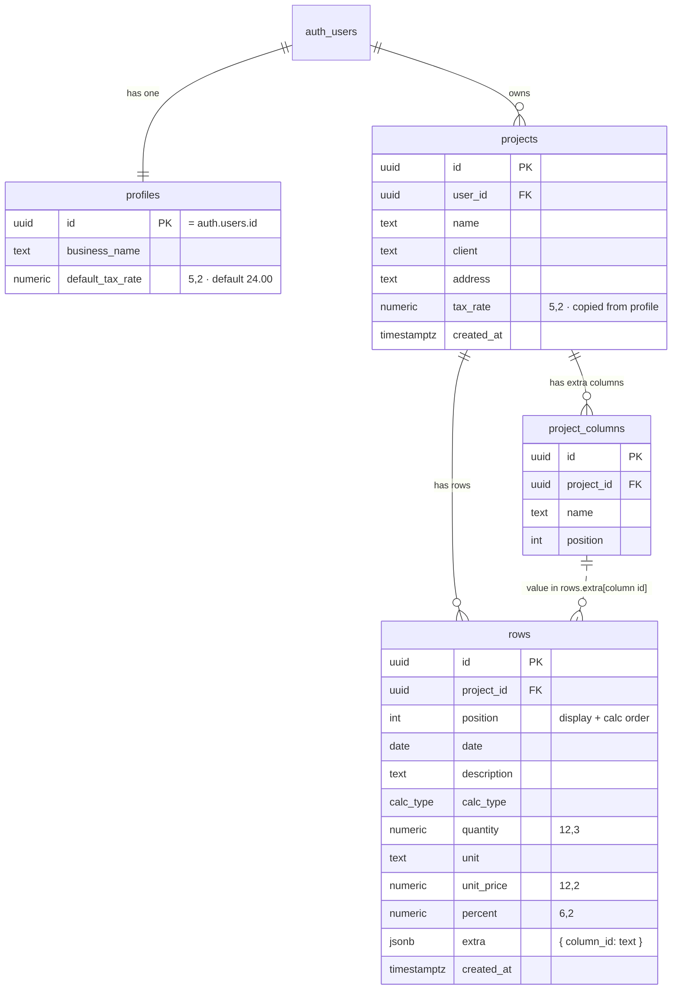

# Database

How the Supabase (Postgres) database for Excel for Dummies is laid out.

> **Status:** design reference written before the first migration. The schema contract lives in `CLAUDE.md`. Once migrations exist, `supabase/migrations/` is the source of truth. Items marked **(proposed)** are not in the contract yet and need a `contract-change` PR before anyone builds them.
> Owner: **Database**. Update this file in the same PR as any schema change.

## Overview



In plain words:
- A **user** (Supabase `auth.users`) has one **profile** with a business name and a default tax rate.
- A user has many **projects**: one per client or address.
- A project has **rows** (the lines of the table) and optionally its own **extra columns**.
- The values of the extra columns live inside each row, in `rows.extra`, keyed by the column's id.
- **Line totals, subtotal, tax and total are never stored.** `lib/calc.ts` computes them.

## Types

```sql
create type calc_type as enum ('fixed', 'qty_price', 'percent');
```

| Value | UI label (et) | Uses |
|---|---|---|
| `fixed` | Kindel summa | `unit_price` |
| `qty_price` | Kogus × hind | `quantity`, `unit`, `unit_price` |
| `percent` | % ülalolevatest ridadest | `percent` |

## Tables

### `profiles`
One row per user, created automatically when the user signs up (see [Triggers](#triggers)).

| Column | Type | Null | Default | Notes |
|---|---|---|---|---|
| `id` | `uuid` | no | | PK, references `auth.users(id)` on delete cascade |
| `business_name` | `text` | yes | | Shown in row 1 of the export |
| `default_tax_rate` | `numeric(5,2)` | no | `24.00` | Percent. Copied into each **new** project only |

### `projects`

| Column | Type | Null | Default | Notes |
|---|---|---|---|---|
| `id` | `uuid` | no | `gen_random_uuid()` | PK |
| `user_id` | `uuid` | no | | References `auth.users(id)` on delete cascade |
| `name` | `text` | no | | Also used in the export filename and sheet name |
| `client` | `text` | yes | | |
| `address` | `text` | yes | | |
| `tax_rate` | `numeric(5,2)` | no | | Percent, e.g. `24.00`. Set from `profiles.default_tax_rate` when the project is created. Never updated when the default changes |
| `created_at` | `timestamptz` | yes | `now()` | |

Index: `projects (user_id)`.

### `project_columns`
The user's own extra columns. Text only, and never used in calculations.

| Column | Type | Null | Default | Notes |
|---|---|---|---|---|
| `id` | `uuid` | no | `gen_random_uuid()` | PK. Also the key in `rows.extra` |
| `project_id` | `uuid` | no | | References `projects` **on delete cascade** |
| `name` | `text` | no | | Column header shown in the table and the export |
| `position` | `int` | no | | Left-to-right order between Description and Quantity |

Index: `project_columns (project_id, position)`.

### `rows`

| Column | Type | Null | Default | Notes |
|---|---|---|---|---|
| `id` | `uuid` | no | `gen_random_uuid()` | PK |
| `project_id` | `uuid` | no | | References `projects` **on delete cascade** |
| `position` | `int` | no | | Display order **and** calculation order (percent rows sum everything above them) |
| `date` | `date` | yes | | Exported as `dd.mm.yyyy` |
| `description` | `text` | no | | |
| `calc_type` | `calc_type` | no | `'fixed'` | |
| `quantity` | `numeric(12,3)` | yes | | `qty_price` only |
| `unit` | `text` | yes | | e.g. `m²`, `h`, `tk` |
| `unit_price` | `numeric(12,2)` | yes | | `fixed` and `qty_price` |
| `percent` | `numeric(6,2)` | yes | | `percent` only. Negative = discount, e.g. `-10.00` |
| `extra` | `jsonb` | no | `'{}'` | `{ "<project_column_id>": "text value" }` |
| `created_at` | `timestamptz` | yes | `now()` | |

Index: `rows (project_id, position)`.

#### Check constraint: required fields per type

```sql
alter table rows add constraint rows_required_fields check (
  case calc_type
    when 'fixed'     then unit_price is not null
    when 'qty_price' then quantity is not null and unit_price is not null
    when 'percent'   then percent is not null
  end
);
```

The zod schemas in the server actions enforce the same rules, so the user sees a friendly Estonian message instead of a database error.

Fields a type doesn't use may still hold old values, e.g. after the user switches a row from `qty_price` to `fixed`. `lib/calc.ts` ignores them and the export writes only the fields the type uses. Keeping them means switching back restores what the user typed.

#### Example rows

| position | description | calc_type | quantity | unit | unit_price | percent | line total (computed) |
|---|---|---|---|---|---|---|---|
| 1 | Seinte krohvimine | qty_price | 10.000 | m² | 4.50 | | 45.00 |
| 2 | Tööjõud | qty_price | 8.000 | h | 25.00 | | 200.00 |
| 3 | Transport | fixed | | | 30.00 | | 30.00 |
| 4 | Allahindlus | percent | | | | -10.00 | -27.50 |

Subtotal 247.50 → käibemaks 24% = 59.40 → total 306.90.

## Row Level Security

RLS is **enabled on every table**. Every policy targets the `authenticated` role. Anonymous users can't see anything.

| Table | select / insert / update / delete allowed when |
|---|---|
| `profiles` | `id = auth.uid()` (no insert or delete from the client; the trigger creates the row) |
| `projects` | `user_id = auth.uid()` |
| `project_columns` | the parent project belongs to the user |
| `rows` | the parent project belongs to the user |

Example for the child tables:

```sql
create policy "own project rows" on rows
  for all to authenticated
  using (exists (select 1 from projects p where p.id = rows.project_id and p.user_id = auth.uid()))
  with check (exists (select 1 from projects p where p.id = rows.project_id and p.user_id = auth.uid()));
```

The app always uses the user's session (anon key + cookies). The service-role key is never used in request handling and never reaches the browser.

## Triggers

### `on_auth_user_created`
Runs after insert on `auth.users` and creates the matching `profiles` row with the default tax rate.

```sql
create function public.handle_new_user() returns trigger
language plpgsql security definer set search_path = '' as $$
begin
  insert into public.profiles (id) values (new.id);
  return new;
end $$;

create trigger on_auth_user_created
  after insert on auth.users
  for each row execute function public.handle_new_user();
```

## RPC functions

Both run as `security invoker`, so RLS still applies. A user can't touch another user's project through them.

### `reorder_rows(p_project_id uuid, p_row_ids uuid[])`
Rewrites `position` for every row of the project in one transaction. `p_row_ids` is the full new order, and row `p_row_ids[i]` gets `position = i`. It raises an error unless the array contains exactly the project's row ids.

Also used for **duplicate**: insert the copy at the end, then call `reorder_rows` to move it directly below the original.

### `delete_column(p_column_id uuid)`
In one transaction it:
1. removes the key from every row of that project: `update rows set extra = extra - p_column_id::text where project_id = …`
2. deletes the `project_columns` row

## How things are created

| Action | What happens in the DB |
|---|---|
| Sign up | Trigger creates `profiles` with `default_tax_rate = 24.00` |
| New project | Insert into `projects` with `tax_rate` = the user's current `default_tax_rate` |
| Change default tax rate | Update `profiles` only. Existing projects keep their own `tax_rate` |
| Add row | Insert with `position = max(position) + 1` (or 1 if the project is empty) |
| Delete row | Delete. Gaps in `position` are fine because order is what counts |
| Add column | Insert into `project_columns` with `position = max + 1`. Rows get the key only when the user types a value |
| Rename column | Update `project_columns.name`. `rows.extra` is keyed by id, so nothing else changes |
| Delete column | `delete_column` RPC |
| Delete project | Cascades to its rows and columns |

## Money and numbers

- All amounts are `numeric`, **never float**. In TypeScript they arrive as numbers or strings. `lib/calc.ts` converts them to integer cents before doing any math.
- `tax_rate` and `percent` are stored as percents (`24.00`, `-10.00`), not fractions. The export divides them by 100 for the `%`-formatted Excel cells.

## Proposed additions (not in the contract yet)

Each needs a `contract-change` PR before it's built:
- `check (tax_rate between 0 and 100)` on `projects`, and the same on `profiles.default_tax_rate`
- `check (jsonb_typeof(extra) = 'object')` on `rows`

## Workflow

- Every schema change is a new numbered file in `supabase/migrations/`. Never edit a merged migration.
- `npx supabase db reset` re-runs the migrations and `supabase/seed.sql` locally.
- After a change, regenerate the types: `npx supabase gen types typescript --local > lib/types.db.ts`
- Production: `npx supabase db push` to the hosted project.
